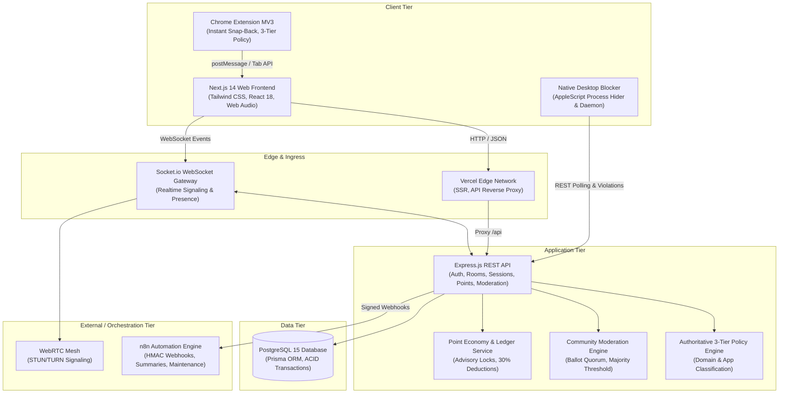

# ZENITH — SYSTEM ARCHITECTURE SPECIFICATION

**Version:** 1.0.0  
**Stack:** Next.js 14 App Router, Node.js + Express, PostgreSQL (Prisma ORM), Socket.io, WebRTC, Manifest V3 Browser Extension, Native Node.js Desktop Blocker.

---

## 1. HIGH-LEVEL TOPOLOGY



---

## 2. SYSTEM BOUNDARIES & AUTHORITIES

| Component | Authoritative Responsibilities | Explicitly Forbidden Operations |
| :--- | :--- | :--- |
| **Frontend Web App** | Rendering UI components, atmospheric backgrounds, local sound synthesis, camera/mic capture, rendering optimistic UI with rollback. | Trusted point/XP calculations, bypassing room entry fees, deciding moderation outcomes, setting focus scores. |
| **REST Backend API** | User authentication, password hashing, JWT minting/verification, room allocation, focus scoring, session lifecycle validation, database transactions. | Storing plaintext passwords, returning unauthenticated user telemetry to guests, swallowing database failures. |
| **WebSocket Gateway** | Authenticated presence, WebRTC SDP/ICE exchange, timer broadcast, moderation ballot delivery, participant kick execution. | Unauthenticated room join, transmitting voice audio in silent focus rooms. |
| **Database (PostgreSQL)** | Referential integrity, atomic point balance increments/decrements via advisory locks, unique constraints, incident audit logs. | Client-side direct connection, non-transactional currency updates. |
| **Chrome Extension (MV3)** | Real-time tab interception, snap-back to active focus room, pausing audio/video on distraction sites during active focus. | Authorizing session bypasses, acting as authoritative data store. |
| **Desktop Blocker** | Querying frontmost macOS process, hiding unapproved apps during focus sessions, reporting violation telemetry. | Enforcing arbitrary commands outside the approved whitelist. |
| **n8n Orchestration** | Asynchronous weekly digest generation, scheduled service maintenance, failure alerts. | Executing synchronous critical-path transactions (room join, XP payment). |

---

## 3. CORE SUBSYSTEM DESIGNS

### 3.1 Room Capacity & Category Rules
- **Education, Exercise, Side Quests (Focus Rooms):** Hard cap of 10 participants. Microphones disabled by server protocol.
- **Interaction Rooms:** Hard cap of 6 participants. Voice communication enabled. Requires 30% weekly XP entrance fee.

### 3.2 30% Weekly XP Economy & Advisory Locking
Entry into interaction rooms invokes:
```sql
SELECT pg_advisory_xact_lock(hashtext('xp_' || userId));
```
Calculates 30% of XP earned since UTC Monday 00:00:00 (minimum floor of 15-20 XP). Atomically records deduction in `point_transactions` and creates `interaction_authorizations`.

### 3.3 Authoritative 3-Tier Policy Engine
- **Tier 1 (Blocked):** Instagram, TikTok, Reddit, Discord, YouTube, Netflix, Twitch, X/Twitter, etc. Cannot be bypassed.
- **Tier 2 (Allowed):** GitHub, LeetCode, Codeforces, HackerRank, Google Search, MDN, StackOverflow, VS Code, Terminal. Cannot be blocked.
- **Tier 3 (Custom):** User-configured domains and applications, subordinate to Tier 1 and Tier 2 rules.

### 3.4 Community Moderation & Auto-Kick Engine
- Participant reports an offender in the same room.
- Creates `ModerationIncident` and freezes eligible voters (up to 8, excluding accused and reporter).
- Ballot window opens for 60 seconds.
- Voting threshold: strictly `yes_votes / eligible_voters > 0.50` (`floor(eligible/2) + 1`).
- Quorum requirement: minimum 50% participation of eligible voters.
- On confirmation: Accused participant is kicked via socket `participant_kicked`, room membership deleted from DB, and `RoomRestriction` (30 min cooldown) recorded.
