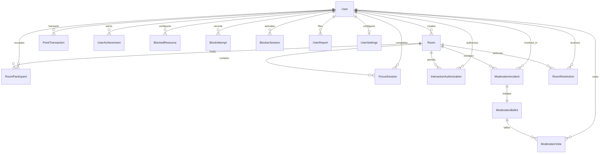

# ZENITH — RELATIONAL DATA MODEL SPECIFICATION

**Database Provider:** PostgreSQL 15  
**ORM:** Prisma ORM  
**Target Schema:** `public`  

---

## 1. ENTITY-RELATIONSHIP OVERVIEW

---

## 2. ENTITY SPECIFICATIONS

### 2.1 User & Settings
- `users`: Core identity record with email, unique username, bcrypt password hash, Google OAuth ID, phone number, and preference flags.
- `user_settings`: User configuration parameters including `blockerMode` (`MONITOR`, `BLOCK`, `STRICT`), `customThemeUrl`, `customThemeTarget` (`DASHBOARD`, `ROOMS`, `BOTH`), `videoLayout` (`footer`, `header`, `middle`, `scattered`), and thresholds.

### 2.2 Rooms & Live Presence
- `rooms`: Focus and Interaction rooms. Fields include `category` (`EDUCATION`, `EXERCISE`, `SIDE_QUEST`, `INTERACTION`), `maxParticipants` (10 for focus, 6 for interaction), `status` (`ACTIVE`, `INACTIVE`), and `atmosphere`.
- `room_participants`: Live seat reservation with `joinedAt`, `lastPing`, `role`, and peer WebRTC IDs.

### 2.3 Focus Sessions & Telemetry
- `focus_sessions`: Authoritative record of completed/interrupted sessions with planned duration, actual focus duration, idle duration, and calculated focus score (0-100).
- `focus_events`: Telemetry events (`TAB_SWITCH`, `IDLE_START`, `WINDOW_BLUR`, `MICROPHONE_DETECTED`).

### 2.4 Point Ledger & Economic Authorizations
- `point_transactions`: Indivisible integer point movements. Positive for rewards (e.g. `SESSION_COMPLETED`), negative for deductions (e.g. `INTERACTION_ROOM`). Contains foreign key reference to session.
- `interaction_authorizations`: Grants access to an Interaction Room after deducting 30% weekly XP. Enforces expiry window.

### 2.5 Policy & Distraction Shield
- `blocked_resources`: Domain and application identifiers categorized by user and type (`WEBSITE`, `APPLICATION`), with `isAllowed` flag for Tier 3 custom overrides.
- `block_attempts`: Audit log of intercepted distraction attempts during active focus sessions.

### 2.6 Community Moderation Engine (New)
- `moderation_incidents`: Records incident lifecycle (`OPEN`, `VOTING`, `CONFIRMED`, `REJECTED`, `INCONCLUSIVE`, `CLOSED`). Links reporter, accused participant, and room.
- `moderation_ballots`: Stores ballot parameters: quorum required, total eligible voters count (max 8), expiry timestamp.
- `moderation_votes`: Unique vote cast by an eligible voter (`incidentId`, `voterId`, `vote: YES | NO`).
- `room_restrictions`: Temporary re-entry ban for kicked participants (`userId`, `roomId`, `expiresAt`, `reason`).
