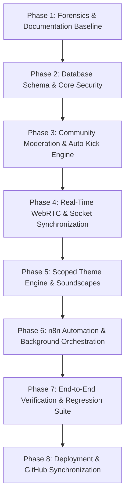

# ZENITH — FULL-STACK MASTER REBUILD PLAN & EXECUTION ROADMAP

**Document Version:** 1.0.0  
**Target Repository:** `/Users/mikey/Desktop/ZENITH`  
**GitHub Remote:** `https://github.com/MIKEY-CODE-HUB/ZENITH.git`  
**Branch:** `main`  
**Last Verified Baseline Commit:** `0c877c5`  

---

## 1. EXECUTIVE MISSION & PURPOSE

Zenith is a high-accountability focus and social study immersion platform. The master rebuilding mission transforms Zenith from an untrusted state into a production-grade, server-authoritative, multi-user platform where:
- All data persistence is backed by PostgreSQL via Prisma ORM;
- Authentication is protected by cryptographic JWT and strict password policies;
- Room matchmaking strictly enforces 10-participant caps for focus rooms and 6-participant caps for interaction rooms;
- Interaction rooms require a 30% weekly XP entrance fee enforced via PostgreSQL row-level advisory locks;
- Distraction blocking is enforced via a Manifest V3 browser extension and a native desktop background guardian;
- Focus sessions and scoring distinguish genuine active focus from passive idling;
- Community moderation incorporates an autonomous, quorum-backed, majority-vote (>50%) ballot system that kicks disruptive participants and enforces temporary room re-entry restrictions;
- Atmosphere themes and music soundscapes provide deep immersion without leaking across scopes;
- Automated background tasks and notifications are orchestrated via secure, authenticated n8n workflows.

---

## 2. RECONSTRUCTION PHASES & DEPENDENCY ORDER

### Phase 1: Repository Forensics & Safe Baseline [COMPLETED]
1. Detailed audit of backend routes, controllers, middleware, and database schema.
2. Verified local PostgreSQL instance running `trapbreaker` database.
3. Confirmed passing state of 77 existing automated tests in `backend/tests/`.
4. Confirmed clean production build of Next.js 14 frontend across 20 routes.
5. Established baseline Git status on `main` and dry-run remote access.
6. Generated authoritative docs in `docs/`.

### Phase 2: Database Schema & Moderation Foundation [CURRENT]
1. Extend `backend/prisma/schema.prisma` with:
   - `ModerationIncident`: Incident tracking with state (`OPEN`, `VOTING`, `CONFIRMED`, `REJECTED`, `INCONCLUSIVE`, `CLOSED`).
   - `ModerationBallot`: Quorum requirement, target eligible voters count (up to 8), voting window timeout.
   - `ModerationVote`: Individual private votes (`YES`, `NO`) linked to eligible voters.
   - `RoomRestriction`: Temporary room re-entry block with expiration timestamp.
2. Apply schema migration to PostgreSQL database via `prisma db push` / `prisma migrate`.
3. Regenerate Prisma Client.

### Phase 3: Server-Authoritative Community Moderation Engine
1. Implement `backend/src/services/moderationService.ts`:
   - Incident creation with duplicate detection and self-report prevention.
   - Snapshot of eligible voters: exclude accused participant, exclude initiating reporter.
   - 8-user voter cap rule: if >= 8 eligible users, select 8; if < 8, select all eligible.
   - Strict majority threshold calculation: `yes_votes / eligible_voters > 0.50` (`floor(eligible/2) + 1`).
   - Quorum enforcement and voting window expiry timer.
   - Atomic outcome resolution: remove participant from DB room membership, insert `RoomRestriction`.
2. Implement `backend/src/controllers/moderationController.ts` and routes.
3. Prevent re-entry: Add room restriction checks in `roomController.joinRoom` and socket `join_room`.

### Phase 4: Real-Time Sockets & Live Room WebRTC Signaling
1. Extend `backend/src/sockets/roomSocketHandlers.ts` with moderation events:
   - `report_participant`: Triggers incident creation and broadcasts `ballot_started` to eligible voters.
   - `cast_moderation_vote`: Records private vote and evaluates resolution.
   - `participant_kicked`: Broadcasts room notification and disconnects accused participant's socket from room.
2. Integrate ballot prompt modal and notification in `frontend/src/app/focus/[id]/page.tsx`.
3. Provide participant reporting action within the `FloatingControlDock` and participant cards.

### Phase 5: Theme Persistence & Personalization Engine
1. Implement validated theme schema with scopes: `DASHBOARD`, `ROOMS`, `BOTH`.
2. Add theme rollback endpoint and preview capabilities.
3. Implement AI theme proposal validation endpoint ensuring no arbitrary script or CSS injection.

### Phase 6: n8n Automation Workflows & Webhooks
1. Provide production-ready n8n workflow definitions for:
   - Session completion digest.
   - Weekly productivity summary.
   - Service health and stale room reconciliation.
2. Implement HMAC webhook validation middleware for backend-to-n8n communication.

### Phase 7: Verification & Testing
1. Unit tests for ballot math, quorum, tie-breaking (e.g. 50% vs 51%), and timeouts.
2. Concurrency tests for simultaneous votes and duplicate reports.
3. Multi-user socket integration tests for live room kick and re-entry rejection.
4. Run full test suite (`backend npm test`).

### Phase 8: GitHub Commit & Push Discipline
1. Coherent checkpoint commits with descriptive conventional commit messages.
2. Continuous push to `origin/main`.
3. Verification of remote commit status.
