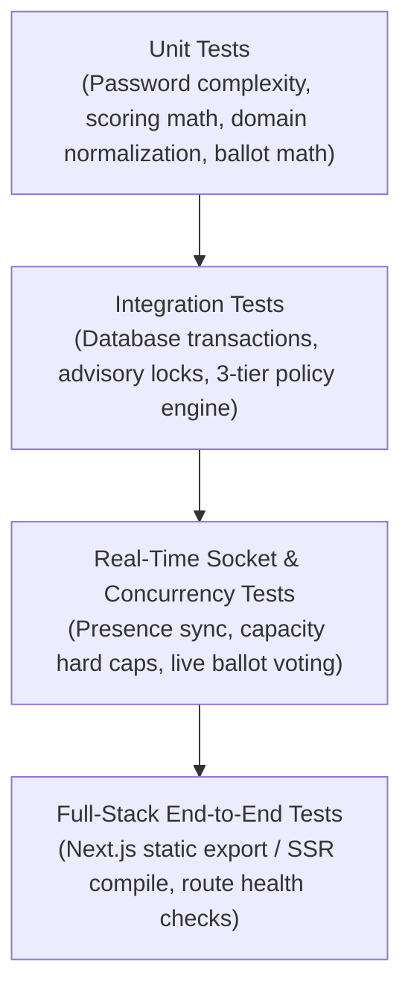

# ZENITH — TEST STRATEGY & VERIFICATION METHODOLOGY

---

## 1. AUTOMATED TESTING HIERARCHY

Zenith employs a 4-tier testing pyramid to guarantee system reliability:

---

## 2. TEST EXECUTION & PASS CRITERIA

| Test Suite | File Location | Key Validations |
| :--- | :--- | :--- |
| **Authentication & Identity** | `backend/tests/auth.test.ts` | Password complexity, bcrypt hashing, JWT issuance and rejection. |
| **Room Presence & Signaling** | `backend/tests/roomPresence.test.ts` | Multi-peer presence, socket disconnect cleanup, WebRTC signaling. |
| **Dynamic Matchmaking** | `backend/tests/matchmaking.test.ts` | Atomic room capacity allocation across 20 concurrent simulated users. |
| **Policy Engine** | `backend/tests/policyEngine.test.ts` | Tier 1/2/3 URL normalization, precedence conflicts, default-deny. |
| **Blocker Multi-User Isolation** | `backend/tests/blockerIsolation.test.ts` | Cross-user shield separation, rule conflict detection. |
| **Desktop Blocker Daemon** | `backend/tests/desktopBlocker.test.ts` | AppleScript app evaluation, telemetry reporting, standby mode. |
| **Master QA & Regression** | `backend/tests/masterQAE2E.test.ts` | BUG-001 through BUG-006 regression checks, honest 0% analytics. |
| **Community Moderation** | `backend/tests/moderation.test.ts` | Quorum calculation, >50% majority threshold, timeout, auto-kick, re-entry denial. |

---

## 3. EVIDENCE RECORDING RULES

1. Every test must produce programmatic pass/fail status without human speculation.
2. Two-user tests must execute with two distinct authenticated user tokens and sockets.
3. No fake pass statuses allowed: if an external dependency is not configured, the test is marked `BLOCKED`.
