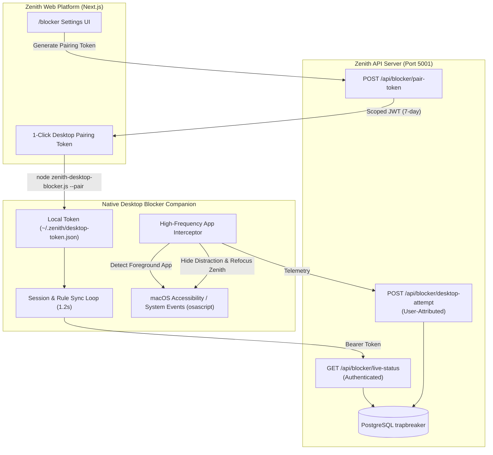

# ZENITH — Phase 1 Evidence Report & Phase 2 Desktop Blocker Master Plan

**System:** Zenith Focus Enforcement System  
**Branch:** `feat/desktop-application-blocker`  
**Host Environment:** macOS (Darwin 24.x)  
**Date:** 2026-10-17  

---

## 1. Phase 1 — Chrome MV3 Focus Enforcement Extension: Evidence & Verification

Phase 1 established the browser-level enforcement infrastructure, authoritative three-tier policy engine, tab monitoring, and anti-loop recovery.

### 1.1 Verified Capabilities & Completed Deliverables
1. **Authoritative Three-Tier Policy Engine**:
   - Standardized in `backend/src/config/shieldDomains.ts`, `frontend/src/lib/shieldDomains.ts`, and `shared/policyEngine.ts`.
   - **Tier 1 (Always Blocked)**: 16 protected distraction domains (`instagram.com`, `reddit.com`, `youtube.com`, `netflix.com`, `tiktok.com`, `discord.com`, `x.com`, `twitter.com`, etc.).
   - **Tier 2 (Always Allowed)**: Standardized essential tools including Google Search (`google.com`, `google.co.in`, `google.co.uk`), `github.com`, `leetcode.com`, `codeforces.com`, `stackoverflow.com`, `developer.mozilla.org`, `docs.google.com`, `drive.google.com`, `vscode.dev`.
   - **Tier 3 (User Custom Rules)**: Allowlist and blocklist custom rules persisted in PostgreSQL `BlockedResource` table with unique user scoping.
2. **Deterministic Rule Precedence**:
   - `SYSTEM` exemptions (internal browser schemes `chrome://*`, Zenith app origins `localhost`, `127.0.0.1`, `zenith.app`).
   - `TIER_1` absolute override over conflicting user allow rules.
   - `TIER_2` absolute override over accidental user block rules.
   - `TIER_3` custom rules (`ALLOW` or `BLOCK`).
   - Default policy: In `STRICT` mode, unknown destinations are blocked (default-deny); in `BLOCK` mode, unlisted destinations are permitted.
3. **Multi-User Isolation**:
   - `GET /api/blocker/live-status` secured with JWT authorization. User A's session is strictly isolated from User B.
   - Conflict validation in `BlockerService.createResource` provides descriptive HTTP 400 rejection banners.
4. **Manifest V3 Background Service Worker & Content Guardian**:
   - Persistent `chrome.storage.local` hydration surviving service worker suspension.
   - Navigation interception via `chrome.webNavigation.onBeforeNavigate`.
   - Anti-loop tab-switching debouncer with a 1,500ms cooldown window and max 3-consecutive retry failsafe.
5. **UI & Bundle Distribution**:
   - Segmented `Allow` vs `Block` selector in `frontend/src/app/blocker/page.tsx`.
   - Automated distribution script `npm run sync:extension` synchronizing `zenith-extension/` into `frontend/public/zenith-extension.zip`.
6. **Verification Evidence**:
   - **Backend Test Suite**: 50/50 tests passing across 19 suites in `backend/tests/`.
   - **Frontend Production Build**: Clean compilation across all 20 Next.js routes with 0 TypeScript/ESLint errors.
   - **Git Milestones**: Fully merged into `main` and pushed to `origin/main` (commit `97f33a7`).

### 1.2 Documented Phase 1 Browser Limitations
1. **Browser Boundary**: The extension operates exclusively within Chromium-based browsers (Chrome, Brave, Edge). Native desktop applications (e.g. native Discord, Steam, Spotify, Telegram) run outside the browser and cannot be intercepted by Chrome extension APIs.
2. **Incognito / Private Browsing**: Chrome requires explicit user consent in `chrome://extensions` ("Allow in Incognito") to enable extension scripts in private windows.
3. **Internal Chrome Web Store / Settings**: Chromium forbids content script injection and navigation blocking on `chrome://*` and the Chrome Web Store.
4. **Task Manager & Force-Disable**: A user with local operating system administrative privileges can disable an extension via browser settings or kill browser processes.

---

## 2. Phase 2 — Native Desktop Application Blocker Architecture

Phase 2 addresses native operating-system applications outside the web browser, providing a transparent, consent-based, multi-user isolated desktop companion daemon.

### 2.1 Target Operating System & Platform Strategy
- **Primary Host OS**: **macOS (Darwin)**.
  - Foreground application detection: AppleScript via `osascript` (`tell application "System Events" to get name of first application process whose frontmost is true`).
  - Distraction interception: Safe process hiding (`tell application "System Events" to set visible of process ... to false`) and window minimization without destructive `SIGKILL` or data loss.
  - Zenith refocus: Automatically brings the primary browser window containing the active Zenith focus room to the foreground.
- **Cross-Platform Extensibility**:
  - Modular `DesktopAppDetector` interface separating OS-specific window queries (macOS AppleScript, Windows `GetForegroundWindow`, Linux `xdotool`/`wayland-info`) from core policy evaluation.

### 2.2 Desktop Application Rule Hierarchy
- **Tier 1 (Predefined Blocked Apps)**:
  `Discord`, `Spotify`, `Steam`, `Telegram`, `WhatsApp`, `Slack`, `Epic Games`, `Battle.net`, `LeagueClient`, `RiotClientServices`.
- **Tier 2 (Predefined Allowed Apps — Essential Tools)**:
  `Google Chrome`, `Brave Browser`, `Arc`, `Safari`, `Terminal`, `iTerm2`, `Code` (VS Code), `Cursor`, `Windsurf`, `Xcode`, `Android Studio`, `IntelliJ IDEA`, `WebStorm`, `PyCharm`, `Finder`, `Zenith`, `Antigravity`.
- **Tier 3 (User-Configured Custom Rules)**:
  - Custom Allowed Apps: Evaluated before default-deny in `STRICT` mode.
  - Custom Blocked Apps: Blocked in both `STRICT` and `BLOCK` modes.
- **Precedence Logic**:
  1. If session is **INACTIVE**: 0 apps blocked, zero interference.
  2. If foreground app is in **Tier 2 (Always Allowed)**: Always permitted.
  3. If foreground app is in **Tier 1 (Always Blocked)**: Blocked during active session.
  4. If foreground app is in **Tier 3 (Custom Allowed)**: Permitted.
  5. If foreground app is in **Tier 3 (Custom Blocked)**: Blocked.
  6. If app is **Unknown**:
     - `STRICT` mode: Blocked (Default-Deny for unapproved apps).
     - `BLOCK` mode: Permitted (Only explicitly blocked apps are hidden).

### 2.3 Authentication & Multi-User Isolation
1. **Desktop Pairing Endpoint**: `POST /api/blocker/pair-token` generates an authenticated, user-scoped 7-day companion token.
2. **Authenticated Polling**: Companion polls `GET /api/blocker/live-status` with `Authorization: Bearer <token>`. Returns user-scoped active session and includes `allowedApps` alongside `blockedApps`.
3. **Attributed Telemetry**: `POST /api/blocker/desktop-attempt` verifies the caller's JWT identity and ensures distraction attempts are recorded strictly against the authenticated user's session.
4. **Zero-Configuration CLI Pairing**:
   - `npm run blocker -- --pair <TOKEN>` stores credentials to `~/.zenith/desktop-token.json`.
   - Environment variable `ZENITH_AUTH_TOKEN` supported for automated setups.

### 2.4 Safety, Permissions & Failsafe Guarantees
- **No Destructive Operations**: Distracting apps are hidden (`visible = false`), never killed or force-quit, preventing user document or unsaved state loss.
- **Immediate Graceful Teardown**: Interception of `SIGINT` (Ctrl+C) and `SIGTERM` exits immediately with zero lingering processes, hooks, or system locks.
- **Anti-Thrashing Cooldown**: 400ms polling rate with 3-second logging debounce preventing CPU spikes.

---

## 3. Implementation Sequence

1. **Backend Enhancements**:
   - Add `POST /api/blocker/pair-token` route in `blockerRoutes.ts`.
   - Update `GET /api/blocker/live-status` to return `allowedApps`.
   - Secure `POST /api/blocker/desktop-attempt` with user authentication and isolation.
2. **Automated Backend & Desktop Test Suite**:
   - Create `backend/tests/desktopBlocker.test.ts` verifying authentication, multi-user isolation, application rule precedence, and telemetry attribution.
3. **Desktop Companion Upgrade**:
   - Overhaul `zenith-desktop-blocker/zenith-companion.js` with token management, pairing CLI, multi-user isolation, Tier 1/2/3 app evaluation, and graceful failsafes.
   - Add `zenith-desktop-blocker/package.json` and standalone runner.
4. **Frontend UI Integration**:
   - Enhance `frontend/src/app/blocker/page.tsx` with a Desktop Blocker companion card, 1-click token copy, and terminal pairing snippet.
5. **End-to-End Verification & Git Discipline**:
   - Run full test suite and production build.
   - Commit verified changes and push to `origin/feat/desktop-application-blocker`.
